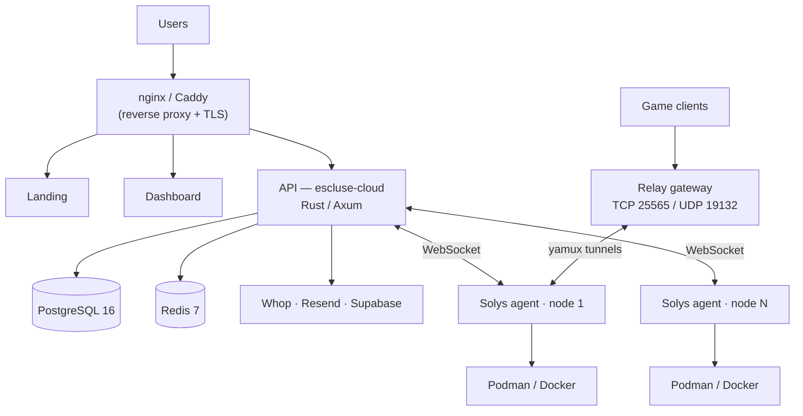

# Escluse

**Your hardware, your rules.** Game server software you run on machines you already own.
You bring the servers, it brings the panel.

**Website:** [esclusehg.com](https://esclusehg.com) · **Docs:** [escluse-docs](https://github.com/esclusehq/escluse-docs)

## What it is

Escluse does roughly what Pterodactyl or AMP does, except you're not renting compute
from anyone. Install the **Solys** agent on a Linux box (a cheap VPS, a dedicated
server, an old desktop in the cupboard), pair it with your dashboard, and every server
ends up on one screen: mod and modpack installs, file manager, live console, backups,
metrics and scheduling.

Minecraft, Java and Bedrock, works today. More games get added as people ask for them.

## Architecture

One Rust API in the middle and everything talks to it. Each node runs the Solys agent,
which keeps a WebSocket open back to the API and does the actual work locally: pulling
images, starting containers through Bollard, reporting results. The dashboard is a
React 19 app talking REST at that same API.



Creating a server goes like this: the dashboard calls the API, the API writes the
record and queues a provision task, the agent picks it up over the WebSocket, pulls the
image, creates the container and reports back, then the API flips the status to
`running`. Backups, alert checks and webhooks are background tasks living in the same
API process.

Nothing unusual in the data layer either, just PostgreSQL 16 and Redis 7.

## Repositories

Actively developed:

| Repository | What it is |
|------------|------------|
| [escluse-cloud](https://github.com/esclusehq/escluse-cloud) | Rust/Axum API, background jobs and the SQL migrations |
| [escluse-dashboard](https://github.com/esclusehq/escluse-dashboard) | React 19 dashboard |
| [escluse-landing-page](https://github.com/esclusehq/escluse-landing-page) | Marketing site |
| [escluse-infra](https://github.com/esclusehq/escluse-infra) | Compose files, nginx/Caddy config, relay gateway |
| [solys](https://github.com/esclusehq/solys) | The agent you install on your machines |
| [agent-core](https://github.com/esclusehq/agent-core) | Shared Rust crates the agent is built from |
| [escluse-docs](https://github.com/esclusehq/escluse-docs) | VitePress documentation |

Kept around, no longer developed:

| Repository | What it is |
|------------|------------|
| [escluse-bridge](https://github.com/esclusehq/escluse-bridge) | Standalone admin panel |
| [escluse-bot](https://github.com/esclusehq/escluse-bot) | Discord moderation and onboarding bot |
| [escluse-sdk](https://github.com/esclusehq/escluse-sdk) | TypeScript and Python SDKs, plus a CLI |
| [escluse](https://github.com/esclusehq/escluse) | The monorepo it all started in, split later |

This page and the org templates live in [.github](https://github.com/esclusehq/.github).

## Tech stack

| Layer | Technology |
|-------|-----------|
| Backend | Rust, Axum 0.7, Tokio, SQLx |
| Agent | Rust, Tokio, Bollard (Podman or Docker) |
| Frontend | React 19, TypeScript, Vite, Zustand, Tailwind |
| Data | PostgreSQL 16, Redis 7 |
| Auth / billing | Supabase, Whop, Resend |
| Edge | nginx or Caddy for TLS, Docker images |

## Domains

`esclusehg.com` for the landing page, `app.` for the dashboard, `api.` for the backend,
`get.` for agent downloads and `*.play.` for relay traffic.

## Get started

Put the agent on a Linux machine:

```bash
curl -fsSL https://get.esclusehg.com/latest/install.sh | bash
```

Then open [esclusehg.com](https://esclusehg.com) and sign in.
