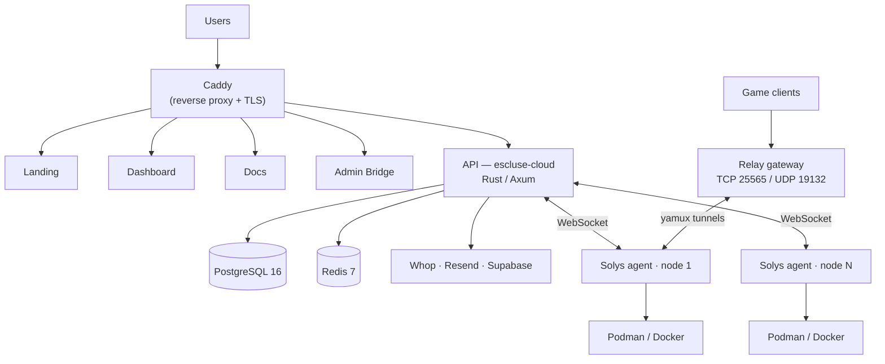

# Escluse

**Your hardware, your rules.** Self-hosted game server management — you bring the
machines, Escluse provides the software.

**Website:** [esclusehg.com](https://esclusehg.com) · **Docs:** [docs.esclusehg.com](https://docs.esclusehg.com)

---

## What it is

Escluse is a game server management platform. Install the lightweight **Solys** agent
on any Linux machine — a VPS, a dedicated server, or an old laptop — link it to your
dashboard, and manage game servers from one place: one-click mod and modpack installs,
backups, live console, monitoring, and scheduling. No lock-in, and no paying for
compute you already own.

Supported today: **Minecraft (Java & Bedrock)**. More games follow community requests.

---

## Architecture

A central Rust API orchestrates everything. Each node runs the Solys agent, which keeps
a persistent WebSocket connection to the API and drives the local container runtime.
The React dashboard and the rest of the frontends talk REST to the same API.



**Server lifecycle:** the dashboard calls the API → the API records the server and
enqueues a provision task → the agent receives it over its WebSocket, pulls the image,
and creates the container via Bollard → the agent reports the result → the API flips
the server to `running`. Backups, alert evaluation, and webhooks run as in-process
background services.

---

## Repositories

| Repository | What it is |
|------------|------------|
| [escluse-cloud](https://github.com/esclusehq/escluse-cloud) | Rust/Axum backend API + background jobs |
| [escluse-dashboard](https://github.com/esclusehq/escluse-dashboard) | React 19 user dashboard |
| [escluse-landing-page](https://github.com/esclusehq/escluse-landing-page) | Marketing site |
| [escluse-infra](https://github.com/esclusehq/escluse-infra) | Docker Compose, Caddy, relay gateway |
| [escluse-bridge](https://github.com/esclusehq/escluse-bridge) | Standalone admin panel |
| [escluse-bot](https://github.com/esclusehq/escluse-bot) | Discord moderation & onboarding bot |
| [escluse-sdk](https://github.com/esclusehq/escluse-sdk) | TypeScript & Python SDKs, OpenAPI spec, CLI |
| [escluse-docs](https://github.com/esclusehq/escluse-docs) | VitePress documentation |
| [solys](https://github.com/esclusehq/solys) | Rust node agent (Web Agent) |
| [agent-core](https://github.com/esclusehq/agent-core) | Rust workspace — 12 shared agent crates |
| [escluse](https://github.com/esclusehq/escluse) | Legacy monorepo (superseded by the split repos) |
| [.github](https://github.com/esclusehq/.github) | Org profile & templates |

---

## Tech stack

| Layer | Technology |
|-------|-----------|
| Backend | Rust, Axum 0.7, Tokio, SQLx |
| Agent | Rust, Tokio, Bollard (Podman/Docker) |
| Frontend | React 19, TypeScript, Vite, Zustand, Tailwind |
| Data | PostgreSQL 16, Redis 7 |
| Auth / billing | Supabase (auth), Whop (billing) |
| Edge | Caddy (TLS), AWS ECR (images) |

---

## Domains

`esclusehg.com` (landing) · `app.` (dashboard) · `api.` (backend) · `docs.` ·
`bridge.` (admin) · `get.` (agent downloads) · `*.play.` (relay, player traffic)

---

## Get started

Install the agent on a Linux machine and link it to your dashboard:

```bash
curl -fsSL https://get.esclusehg.com/latest/install.sh | bash
```

Then visit [esclusehg.com](https://esclusehg.com). See
[docs.esclusehg.com](https://docs.esclusehg.com) for the full setup guide.
